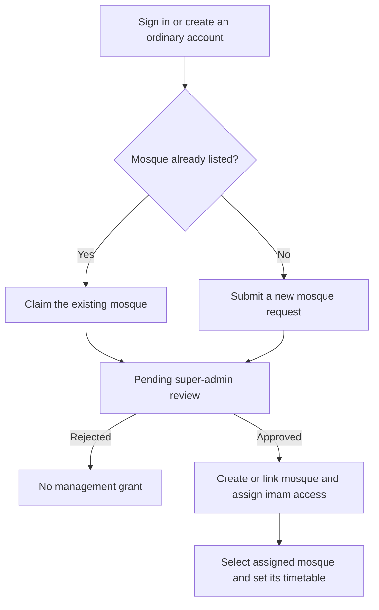

# Masjid Prayer App — user and owner guide

Updated: **14 October 2026, Asia/Karachi**. This guide describes the current Android app and the reviewed repository rules. English button names are used below; most main screens also support Urdu and RTL. Some registration/management screens still contain English text.

**Before testing:** production Firebase still uses older rules, so guest feeds, comments, member verification, imam approval and account cleanup may fail or have different permissions. The steps below describe the intended reviewed workflows; they require the coordinated backend migration/deployment before public use. See [production audit](scripts/qa/PRODUCTION_AUDIT.md) and [launch plan](launchplan.md). A working APK does not mean those backend changes are deployed.

## 1. Open or run the app

### On an Android phone

The latest debug build is already installed on the connected test phone. Open **Masjid Prayer** from the phone's apps. The current ARM64 APK requires Android 7 / API 24 or newer; it is a testing build, not a signed store release.

On first use, choose a mosque from the directory. Search by name or area, or optionally select **Use my location**. Location permission is optional; manual search works without it. The selected mosque determines the prayer timetable and feeds you see.

The four bottom tabs are:

| Tab | What it does |
| --- | --- |
| **Time** | Selected mosque's prayer times, next-prayer countdown and Friday Jummah when set. |
| **Events** | Approved events, search and All/Upcoming filters. Eligible users can propose events. |
| **Community** | Text-only hadith, ayat, questions, imam answers and comments. |
| **Settings** | Account/profile, selected mosque, language, dark mode, reminders and management tools. |

Change the selected mosque by tapping its card under **Settings → Selected Masjid**. Browsing another mosque does not transfer an imam's management rights or a verified member's approval.

### From this project on your Mac

Use the tested Flutter SDK, **3.44.6**, with Android SDK tools installed. This project requires Dart `^3.10.0`. The Android Firebase configuration must be present at `android/app/google-services.json`; this local file is ignored by Git. Enable USB debugging on your phone and accept its computer-authorization prompt.

```sh
cd /Users/arslananwar/Developer/Active/masjid_app
flutter doctor
flutter pub get
adb devices
flutter devices
```

Copy your phone's ID from the device list, replacing `DEVICE_ID` in the commands below:

```sh
flutter run -d DEVICE_ID
```

While `flutter run` is attached, `r` hot reloads, `R` hot restarts, and `q` ends the development session. To build and install a standalone debug APK on an ARM64 phone:

```sh
flutter build apk --debug --target-platform android-arm64
adb -s DEVICE_ID install -r build/app/outputs/flutter-apk/app-debug.apk
```

The APK is saved at `build/app/outputs/flutter-apk/app-debug.apk`. Installation with `-r` preserves existing data when the package and signing key are compatible. If Android reports a signing conflict, do not uninstall just to bypass it: uninstalling clears local app data. These Flutter commands follow the [official CLI reference](https://docs.flutter.dev/reference/flutter-cli).

The normal build connects to the real configured Firebase project. For isolated role/workflow testing, follow [local emulator QA](scripts/qa/UI_QA.md) instead; its debug web preview uses `USE_FIREBASE_EMULATORS=true`. Never seed QA fixtures into production. Android is the launch target; a Chrome preview does not deliver Android prayer notifications.

## 2. Who can do what?

These permissions assume the **reviewed rules have been deployed**:

| User | Main capabilities | How access is obtained |
| --- | --- | --- |
| **Guest** | View public mosque/prayer information, approved events and community text; set local preferences and optional prayer reminders. Cannot post or comment. | Use the app without signing in. |
| **Muqtaddi** | Guest features plus text posts/comments, profile changes, a verification request and an imam/mosque application. | Create an ordinary account and sign in. |
| **Verified muqtaddi** | Member features plus event proposals for the associated mosque, according to granted event permission. | Assigned imam/admin approves the member request. |
| **Imam / mosque admin** | Manage the assigned mosque's timetable, answers, events and member verification. | Trusted approval assigns the account to that mosque and grants its UID management access. |
| **Super-admin / owner reviewer** | Review mosque registration/claim requests and perform trusted administrative operations. | A reviewed server-issued `superAdmin` claim; there is no public super-admin signup. |

Signing up, choosing a mosque, knowing its name, or using an email containing “admin” does not grant management under the reviewed policy. Each person signs in with their **own account email and password**; the mosque does not have a shared password stored in Firestore.

“Verified muqtaddi” means approved by mosque management. It is separate from Firebase email verification. The current ordinary signup/posting code does not enforce a verified-email prerequisite or automatically send an email-verification link; do not describe that as completed functionality.

## 3. Use the app as a guest

1. Open the app and select a mosque.
2. Read its **Time** page. Times come from the saved mosque timetable, not an automatic astronomical calculation. If times are unset, the imam must add them.
3. Browse **Events** and **Community**. Public reading depends on the corrected backend rules; the current production mismatch can produce load errors.
4. Change English/Urdu or dark mode in **Settings**.
5. Optionally enable prayer reminders using section 7. A user account is not required for that local setting.
6. Select **Settings → Login** when you want to contribute or apply for access.

## 4. Use the app as a muqtaddi

### Create an account and sign in

Open **Settings → Login**, then the signup link leading to **Create Account**. Enter your name (1–100 characters), an email you control, a password of at least six characters, and matching confirmation. The selected mosque is used as the initial account association. Registration creates an ordinary `muqtaddi` account; it never makes you imam automatically.

Use the same email/password to sign in later. For a forgotten password, enter your email on the login screen and select **Forgot password?**. Check your inbox and spam folder. Google sign-in is disabled by default in this MVP and must not be assumed available.

### Post and comment

On **Community**, enter a hadith, ayat or question and submit it. Posts must be text-only, with up to **4,000 characters**. Open a post's comments to read or add a reply of up to **1,000 characters**. Photos, videos and attachment uploads are excluded.

The anonymous option hides your display name in the feed. It does **not** hide your stored author UID from readers of the public post document. You can remove your own contributions using the available delete controls; managers can moderate their mosque's content. Post deletion also cleans its child comments. Failed saves should be retried after resolving the error; check whether the content already exists before submitting it again.

### Request mosque verification

1. Select the mosque you belong to.
2. Open **Settings → Request verification** on your profile card.
3. Your request becomes pending; you remain an ordinary member while waiting.
4. The assigned imam/admin reviews it. Approval changes your role to verified muqtaddi; rejection leaves you an ordinary member and allows a later application.

A verified member's approved association is protected. Selecting another mosque for browsing does not move that approval.

### Propose an event

For your associated mosque, use **Events → Propose an event** when the control is available. Enter a title (up to 200 characters), description (up to 4,000), date, start/end times, category and optional location (up to 500). End time must be after start time.

- `approval_required`: the imam/admin must approve before the event appears publicly.
- `full`: an explicitly authorized verified member may publish directly for the assigned mosque.
- `none`: no event-posting permission.

The current member-review UI grants `approval_required` on approval; it does not provide a full-permission selector. An additional full grant requires a reviewed authorized operation. Unapproved proposals do not appear in the public feed; there is no dedicated member “my pending events” screen to promise here. Event attendance booking/registration is not implemented.

## 5. Apply as an imam or register a mosque

### Prepare these details

| Detail | What is needed now |
| --- | --- |
| Applicant account | A real email you control and your personal account credentials. Existing users reuse their account. |
| Applicant identity | Use your actual name in your account profile. The signed-in request uses the account's name/email automatically. |
| Existing mosque | Find and claim its existing entry; avoid creating a duplicate. |
| New mosque name | Required. The signed-in request is bounded to 200 characters by reviewed rules; the combined new-account form accepts up to 100. Keeping it within 100 works for both routes. |
| Location/area | Required, up to 500 characters: include enough address/area detail for a reviewer to identify the mosque. |
| Authorization | The owner reviewer must confirm you are authorized to manage the mosque before approving. Submission itself is not proof of authority. |
| Prayer timetable | Needed after approval: accurate Fajr, Dhuhr, Asr, Maghrib, Isha and Jummah times, with correct AM/PM. |

The current registration forms do **not** ask for identity-document uploads, a telephone number, a separate mosque password, GPS/map-pin selection, Urdu mosque name, or a Jamia/Jummah checkbox. Some of those metadata fields exist in the model, but their entry workflow is not supplied by these forms. Confirm identity and mosque authorization outside the app during owner review; do not invent an automatic document-verification process.

### Route A — you already have an account

1. Sign in as an ordinary muqtaddi.
2. Open **Settings → Request imam access / register a masjid**.
3. On **Claim or Register Masjid**, search by mosque name or area.
4. If it exists, select **Claim** beside the correct entry. Your account UID/name/email and the mosque ID are attached to a pending request.
5. If it is missing, select **Register New Masjid**, fill **Masjid Name** and **Location/Area**, then **Submit Registration Request**.
6. Wait for super-admin review. Your ordinary account remains usable; the request does not grant management rights.

Already assigned imams/admins do not get this ordinary-member application shortcut. Managing a different mosque requires a reviewed transfer/revocation first.

### Route B — you do not have an account yet

1. Open **Settings → Admin/Imam Panel**. The login screen appears.
2. Select **Register New Masjid**.
3. Fill mosque name, location, your account email, password and matching confirmation. Name is limited to 100 characters; location to 500; password needs at least six characters.
4. Select **Register Masjid**.

This combined form creates a Firebase Auth account and submits a member profile plus a pending new-mosque request. It initially uses the mosque name as the applicant's display name; use **Edit Profile** to set your actual name if needed, and ensure the owner knows who applied. The submitted request retains the name captured at submission.

If the email already belongs to an account, sign in and use **Route A**. The form's wording does not mean immediate admin access. An unsuccessful Auth/profile/request sequence can require owner assistance; do not assume repeated signup will repair a partial account.

### What happens after submitting?



For a new mosque, approval creates its directory document with empty prayer times. For an existing mosque, approval links your UID to the existing entry. The reviewed approval transaction also sets your user role/association and records who reviewed the request; failed approval does not leave a partial set of those Firestore changes.

There is currently no applicant request-status page or approval push alert. Ask the owner reviewer about a pending/rejected request. After approval, reopen the app or sign out/in if your role has not refreshed, select the assigned mosque, and open **Admin/Imam Panel**. Do not resubmit duplicates just because a request is waiting.

## 6. Work as an approved imam

### Set and maintain prayer times

Select your **assigned mosque**, then open **Settings → Admin/Imam Panel** or the contextual prayer-edit control. Pick every prayer time and the Jummah time, check AM/PM, and select **Save Prayer Times**.

Newly approved mosques have no real timetable yet. Picker defaults are not the mosque's prayer times: enter/check every value before saving. Return to **Time** and verify the displayed schedule, including Friday Jummah. Keep it updated when the congregation's timetable changes; users' reminder schedules depend on it.

### Answer questions and manage events

Use the panel's question-management screen to answer community questions (up to 4,000 characters). Assigned managers can answer/moderate their mosque's posts and comments. Event management lets you create/manage events and approve or reject pending proposals. Check the pending queue separately from the public approved-events list.

### Verify members

Open **Settings → Review member verification** for your assigned mosque. Review the applicant, then approve or reject. Approval grants verified-member status with approval-required event permission. Review only people you can appropriately confirm; this is not automatic email or identity-document verification.

Your account's role, mosque association and protected UID grant must agree. If the panel says you are not assigned, ask the owner to review the assignment rather than changing your own role or using another mosque's email. A management handover is an owner-reviewed operation, not a shared-password transfer.

## 7. Configure prayer reminders

Open **Settings → Prayer reminders**:

1. Enable the switch explicitly; new installations start off.
2. Allow notifications and, when Android requests it, **Alarms & reminders** access.
3. Select **Remind me before prayer**. Default is **15 minutes**; presets include 5, 10, 15, 20, 30 and 60, or a custom whole number from **1–60**.
4. Use **Test reminder in 1 minute**, wait for the scheduling confirmation, and send the app to the background to check delivery.

The lead applies to the selected mosque's five prayers. Friday uses valid Jummah instead of Dhuhr; sunrise, sunset and unset/invalid times are skipped. Reminders use the **phone's timezone** and the last saved timetable. Open the app to refresh changed times, mosque selection or timezone. There is no paid server scheduler refreshing a closed app's timetable.

Switching reminders off cancels their pending alerts. Notifications use the Android notification channel/default tone; a full adhan recording is not implemented. Battery restrictions, silent mode, revoked permissions and force-stopping the app can affect delivery.

One controlled Android 14 test delivered with the app in the background. Reboot, deeper battery behavior, tap navigation, all permission-recovery cases and signed-release acceptance still need checks. See [device evidence](scripts/qa/ANDROID_DEVICE_QA.md) and [reminder QA](scripts/qa/PRAYER_REMINDERS.md).

## 8. Where is the data stored?

### Cloud data

Firebase project: **`masjid-prayer-app-49f50`**. A read-only metadata check on 14 October confirmed the default Cloud Firestore database uses **`asia-south1`**, which Firebase lists as **Mumbai, India**. This is the Firestore database location; Firebase Authentication is a separate service whose data location was not checked. See [Firebase's location reference](https://firebase.google.com/docs/firestore/locations).

Firestore stores application records as documents inside collections/subcollections. The paths below come from this app's source; see the [Firestore data model](https://firebase.google.com/docs/firestore/data-model) for the underlying structure.

| Data | Storage location | Contents / reviewed access |
| --- | --- | --- |
| Sign-in identity | **Firebase Authentication** | UID, email, display name and authentication credentials/session. Firebase Auth handles password operations; the app does not put plaintext passwords in Firestore. |
| Account profile | `users/{uid}` | Name/email, role, verification status, event permission, mosque association and account/deletion metadata. Read by the owner, super-admin and appropriately scoped mosque management. |
| Mosque and timetable | `masjids/{masjidId}` | Names, location, prayer/Jummah times, optional coordinates/contact metadata, verification and protected manager UID grants. Publicly readable; only authorized management/reviewers may change permitted fields. |
| Registration/claim application | `claimRequests/{requestId}` | Applicant UID/name/email, mosque ID or proposed name/location, pending/approved/rejected status and review metadata. Applicant/super-admin access under reviewed rules. |
| Community post and imam answer | `masjids/{masjidId}/questions/{postId}` | Text, display name, author UID, timestamp, anonymity/answer flags and answer. Public content under reviewed rules. |
| Comments | `masjids/{masjidId}/questions/{postId}/comments/{commentId}` | Text, author UID/name and server timestamp. Public content under reviewed rules. |
| Events | `masjids/{masjidId}/events/{eventId}` | Title/description, date/times, category/location, author and status. Approved events public; pending proposals restricted to author/authorized management. |
| Super-admin authority | Firebase Auth ID-token **custom claim** | `superAdmin: true`, issued by a trusted server/Admin SDK environment. Not a public signup field or an email-name convention. |

No new community photo/video uploads use Firebase Storage. Legacy event documents may still contain existing media URLs; this guide does not claim those old assets were deleted. The MVP does not persist event attendance registration.

An owner with Firebase project access can inspect accounts in **Firebase Console → Authentication** and records in **Firestore Database → Data**. Console access is separate from an in-app imam role. Do not edit arbitrary role/grant fields to work around approval failures; use the reviewed management/migration process.

### Data on each phone

| Local data | How it is used |
| --- | --- |
| Shared preferences | Selected mosque ID, language/theme and `prayer_reminders_v1` containing enabled/lead-minute preferences. There are also legacy manager-login labels; they do not authorize management. |
| Firebase Auth session | The SDK remembers sign-in on the device. This is separate from the app storing a raw password. |
| Firestore cache | Native configuration enables persistent caching with a 40 MiB cache target. Previously fetched data can remain locally; offline display does not prove a fresh server read or a successful write. |
| Android notification cache/alarms | Scheduled reminder IDs, times, titles and channel settings live on the device/OS. They are not Firestore documents. |
| Bundled assets and temporary app state | Fonts/icons work without downloads. In-memory feed/draft state is not a guaranteed cross-restart backup. |

Cloud account data is not a folder in this GitHub repository. Uninstalling or clearing app data can remove preferences, sessions, cache and reminders on that phone; it does **not** delete the Firebase account or cloud posts. Use the app's account-deletion flow for that.

## 9. Profile, logout, deletion and support

**Settings → Edit Profile** updates the account display name. A password change asks for the current password, new password and confirmation. **Sign out** returns to guest use; it does not delete cloud contributions. Language/theme and reminder preferences belong to the device, so check the reminder switch separately if you want alerts off.

**Delete account** requires reauthentication. The implemented cleanup freezes new contributions, removes attributable posts and their child comments, authored comments/events, mosque requests and the profile, then deletes Firebase Auth. If interrupted, cleanup may partly complete; retry to finish rather than assuming everything rolled back. Managers/super-admins need a reviewed transfer/revocation first. Legacy content without author UIDs needs owner review. The current production rules mismatch blocks this cleanup; do not promise production deletion acceptance until corrected and tested.

**Settings → Help & support** opens a mail app addressed to `sardaribraheem277@gmail.com`. The in-app privacy policy explains public content, optional location, reminders and deletion. There is no automatic expiry/archive schedule promised by this MVP.

## 10. Owner / super-admin operation

Follow [the trusted administrator bootstrap and migration guide](scripts/admin/README.md). Its tool needs a reviewed Firebase Auth UID, an enabled account with verified email and trusted credentials outside Git; it defaults to a read-only preview. Only an explicitly reviewed grant should apply the custom claim. No ordinary user can select the super-admin role.

Once the reviewed backend/claim setup is ready:

1. Sign in with the trusted reviewer account and refresh the token by signing out/in when a claim is newly issued.
2. Open **Settings → Review masjid requests**.
3. Check the applicant, correct mosque/location, duplicate listings and actual authorization.
4. Approve or reject. Approval creates/links the mosque and assigns the applicant atomically in Firestore; rejection grants no management access.
5. Ask the approved imam to select that mosque and enter its real timetable.

Existing privileged users/grants must be audited before deployment; never bulk-trust old role/email values. Current approved managers assigned elsewhere require a reviewed handover before another mosque assignment.

For public release, complete the [launch plan](launchplan.md): timetable-editor fixes and public community moderation, reviewed production migration and rules/index deployment, final Android application ID/Firebase registration, owner-controlled signing, staging/native acceptance and store setup. Confirm entered prayer times against the mosque noticeboard; the current editor's unset-time/default and separate Friday-save behavior are open issues in [MVP_REVIEW.md](MVP_REVIEW.md). Production deployment is a separate authorized action, not something running this guide automatically performs.

## 11. Common problems

| Problem | What to check |
| --- | --- |
| Phone absent or `unauthorized` in ADB | USB debugging, a data-capable cable, unlocked phone and its authorization prompt. Use `flutter devices` to choose the correct device. |
| Build says “No space left on device” | Free space for SDK/Gradle downloads and generated build outputs. Do not delete source, credentials or user data. Re-run the build after resolving space. |
| App cannot initialize Firebase | Check the intended Android configuration, matching application ID and build setup; see [Android release notes](scripts/qa/ANDROID_RELEASE.md). |
| `permission-denied`, comments failing or empty guest feeds | Check login, assigned permission and the known deployed-rules mismatch. Do not bypass it with a client role change. |
| Imam login says account is not linked | Approval/grants are incomplete, the wrong account is signed in, or the wrong mosque is selected. Ask the owner to review UID/assignment. |
| New mosque does not appear | A request does not create a public mosque until approval. Contact the reviewer; avoid duplicate submissions. |
| Request waiting with no status page | Applicant status UI/approval notifications are absent. Ask the owner to review the saved request. |
| Prayer times look wrong | Confirm selected mosque, AM/PM, every saved prayer/Jummah value and phone timezone; contact its imam. |
| No reminder | Confirm the switch, valid timetable, notification/channel and alarm permissions, battery/silent settings, and avoid force-stop. Reopen the app and use the one-minute test. |
| Proposal missing from public events | Approval may still be pending; ask the assigned imam to review. Search/filter results cover loaded pages, so load older items when needed. |
| Failed signup followed by “email already in use” | Sign in with that account and check whether a profile exists. Ask the owner for reviewed repair if registration partly completed. |
| Failed deletion | Reauthenticate, resolve backend/transfer errors, and retry. Some cleanup may already have completed. |

The current implementation is suitable for controlled testing. Follow the documented release gates before inviting the public to rely on the complete role, approval and deletion workflows.
